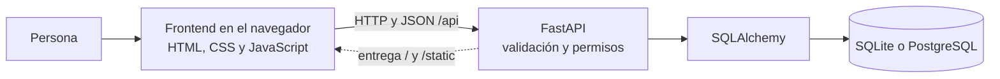
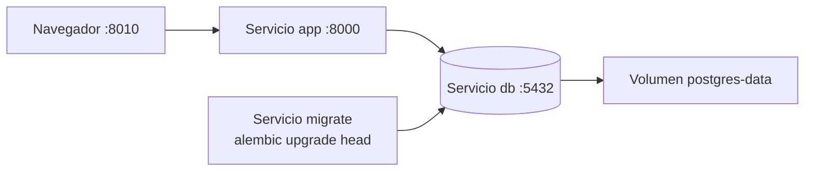
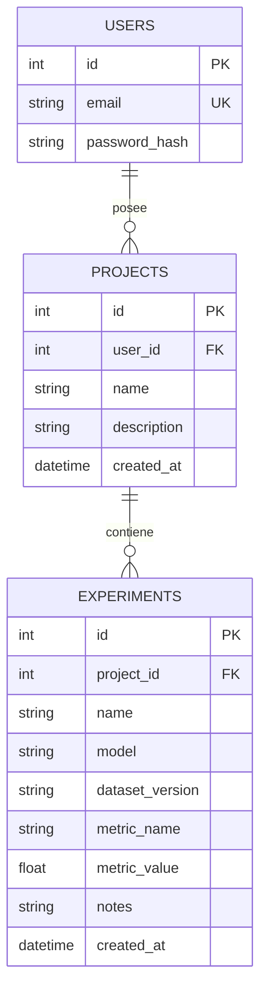

# Requisitos, arquitectura y modelo de datos

## Requisitos y criterios de aceptación

| ID | Requisito | Comprobación |
|---|---|---|
| RF01 | Iniciar y cerrar sesión | Una cookie anterior deja de funcionar al cerrar sesión |
| RF02 | CRUD de proyectos | Crear, leer, modificar y eliminar un proyecto vacío |
| RF03 | CRUD de experimentos | Guardar un experimento dentro de un proyecto propio |
| RF04 | Aislar usuarios | Luis obtiene 404 al pedir, editar o eliminar datos de Ana |
| RF05 | Validar en el servidor | Rechazar nombre vacío, valor no numérico, NaN e infinito con 422 |
| RF06 | Conservar relaciones | No crear experimentos en proyectos inexistentes o ajenos |
| RF07 | Restringir eliminación | Proyecto con experimentos devuelve 409 |
| RF08 | Filtrar por modelo | Comparación exacta del nombre de modelo dentro del proyecto seleccionado |
| RF09 | Resumen real | Contadores cambian al crear y borrar registros propios |
| RNF01 | Persistencia | Los datos sobreviven al reinicio del proceso o recreación de contenedores |
| RNF02 | Reproducibilidad | Una carpeta recién extraída arranca con las instrucciones |
| RNF03 | Interfaz usable | Formularios etiquetados, errores visibles, estado vacío y confirmación de borrado |
| RNF04 | Configuración externa | Secretos en `.env`, ejemplos sin secretos en `.env.example` |

Cada usuario solo trabaja con proyectos propios. No hay roles de administrador en la interfaz ni colaboración entre usuarios. La creación de cuentas se hace mediante una herramienta local del administrador.

## Arquitectura



La interfaz y la API comparten origen. La separación es de responsabilidades: JavaScript ejecuta `fetch`, FastAPI aplica reglas y SQLAlchemy persiste los datos. No es necesario tener tres contenedores para que existan frontend, backend y BD.



El servicio `migrate` ejecuta Alembic una vez y debe terminar correctamente antes de que arranque `app`. `db` no publica un puerto al equipo anfitrión. El frontend se sirve dentro de `app`.

## ERD del dominio



Tablas de soporte: `auth_sessions` guarda el hash del token de sesión, usuario, CSRF y expiración; `login_throttles` registra intentos de acceso por cuenta; `alembic_version` identifica la migración aplicada. Las fechas se almacenan como UTC.

## Contrato de la API

| Método | Ruta | Resultado |
|---|---|---|
| POST | `/api/auth/login` | 200, cookie de sesión y token CSRF |
| GET | `/api/auth/me` | 200, correo y token CSRF de la sesión |
| POST | `/api/auth/logout` | 204, revoca la sesión |
| GET | `/api/projects` | 200, lista de proyectos propios |
| POST | `/api/projects` | 201, proyecto creado |
| GET / PUT / DELETE | `/api/projects/{id}` | 200 / 200 / 204 sobre un proyecto propio |
| GET | `/api/projects/{id}/experiments?model=RandomForest` | 200, experimentos del proyecto; filtro opcional exacto |
| POST | `/api/projects/{id}/experiments` | 201, experimento creado |
| GET / PUT / DELETE | `/api/experiments/{id}` | 200 / 200 / 204 sobre un experimento propio |
| GET | `/api/summary` | 200, cantidades de proyectos y experimentos propios |
| GET | `/health` | 200 si puede consultar la BD; 503 si no |

`PUT` envía todos los campos del formulario. No hay `PATCH`. Un proyecto recibe `name` y `description`. Un experimento recibe `name`, `model`, `dataset_version`, `metric_name`, `metric_value` y `notes`. Los campos desconocidos se rechazan. El navegador no decide el `user_id` ni envía `project_id` dentro del cuerpo.

Ejemplo de experimento:

```json
{"name":"Línea base","model":"RandomForest","dataset_version":"materiales-v1","metric_name":"F1","metric_value":0.84,"notes":"Resultado de ejemplo"}
```

## Autenticación y autorización

La contraseña se verifica con Argon2. El navegador recibe una cookie HttpOnly con un token aleatorio; la BD almacena su hash. La sesión caduca y puede revocarse. Las peticiones autenticadas POST, PUT y DELETE necesitan origen autorizado y cabecera `X-CSRF-Token`; el login también exige origen autorizado. `GET /api/auth/me` permite recuperar el token CSRF al recargar la página.

La autorización se comprueba en cada consulta por propietario. Los IDs ajenos devuelven 404 para no revelar si existen. Ocultar un botón no protege una API.

## Dónde buscar cada cosa

| Carpeta/archivo | Responsabilidad |
|---|---|
| `frontend/` | Pantallas, estilos y peticiones HTTP |
| `app/routes/` | Endpoints de autenticación, proyectos y experimentos |
| `app/schemas.py` | Validación de entrada y respuesta |
| `app/models.py` | Modelo relacional |
| `app/security.py` | Sesión, permisos básicos y CSRF |
| `app/db.py` | Motor y sesiones de BD |
| `migrations/` | Evolución del esquema |
| `tests/` | Comportamiento esperado |
| `compose.yaml` | Servicios y persistencia |

Referencias oficiales: [FastAPI](https://fastapi.tiangolo.com/), [SQLAlchemy](https://docs.sqlalchemy.org/), [Alembic](https://alembic.sqlalchemy.org/), [Docker Compose](https://docs.docker.com/compose/).
